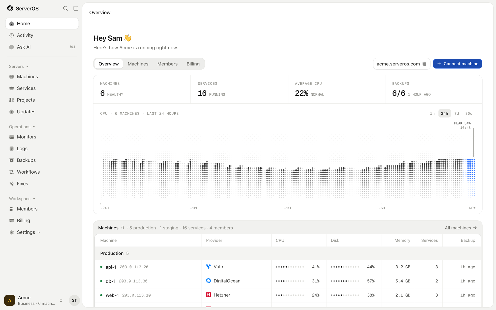

<p align="center">
  <a href="https://serveros.com">
    <picture>
      <source media="(prefers-color-scheme: dark)" srcset="./logo-dark-mode.svg">
      
    </picture>
  </a>
</p>

<h1 align="center">ServerOS</h1>

<p align="center">Deploy, back up and keep an eye on the Linux servers you already own.</p>

<p align="center">
  <a href="https://status.serveros.com"></a>
  <a href="https://docs.serveros.com"></a>
  <a href="https://github.com/serveroshq/panel"></a>
  <a href="https://discord.gg/serveros"></a>
  <a href="https://www.linkedin.com/company/serveros"></a>
</p>

<p align="center">
  <a href="https://serveros.com"></a>
</p>

## One panel for every server, yours or ours

ServerOS connects to the servers you already rent, at any provider. It finds what's running on them and gives you deploys, backups, monitors, logs and alerts for all of it in one place. Your servers stay yours: your account, your bill, your provider.

- **Connect a server in one command.** A small daemon joins your workspace over one outbound connection, so there are no ports to open.
- **See what's already there.** Websites, databases, containers and workers show up on their own. Nothing is restarted or changed.
- **Run it all from one place.** Deploy your code or a one-click app, back up, monitor, read logs, and automate the rest with workflows.
- **From your AI or your own code.** Every workspace has an MCP server for Claude, ChatGPT and Cursor, and a REST API.
- **No server yet?** [ServerOS Cloud](https://serveros.com/cloud) gets you one with ServerOS already set up.

## Open source

| Repo | What it is | License |
| --- | --- | --- |
| [panel](https://github.com/serveroshq/panel) | The ServerOS panel: the web app you and your team work in, the same one serveros.com runs. Free to self-host. | AGPL-3.0 |
| [daemon](https://github.com/serveroshq/daemon) | `serverosd`, the agent that runs on your servers, and the gateway it connects through. Read exactly what runs on your machines. | AGPL-3.0 |

## Self-host it

Run the panel on your own server, free. You need a Linux server with Docker, ports 80, 443 and 8443 open, and A records for a domain like `panel.example.com` and for `*.panel.example.com`. Then:

```sh
curl -fsSL https://raw.githubusercontent.com/serveroshq/panel/main/docker/self-hosted/install.sh | sudo bash -s -- --domain=panel.example.com --email=you@example.com
```

It runs the official image, [`ghcr.io/serveroshq/panel`](https://github.com/serveroshq/panel/pkgs/container/panel), and prints a setup code for the web installer. The [self-hosting guide](https://docs.serveros.com/guides/self-hosting) has the rest.

## Contributing

Want to help? Start with the repo's `CONTRIBUTING.md`, say hi in [Discussions](https://github.com/serveroshq/panel/discussions), and report security problems privately to [security@serveros.com](mailto:security@serveros.com).

## Links

- [serveros.com](https://serveros.com)
- [Docs](https://docs.serveros.com)
- [Status](https://status.serveros.com)
- [Changelog](https://serveros.com/changelog)
- [Blog](https://serveros.com/blog)

## Get in touch

Questions, ideas or something broken: [support@serveros.com](mailto:support@serveros.com), or come and chat on [Discord](https://discord.gg/serveros).

ServerOS is made by [ServerOS Cloud Ltd](https://serveros.cloud), registered in England and Wales.
