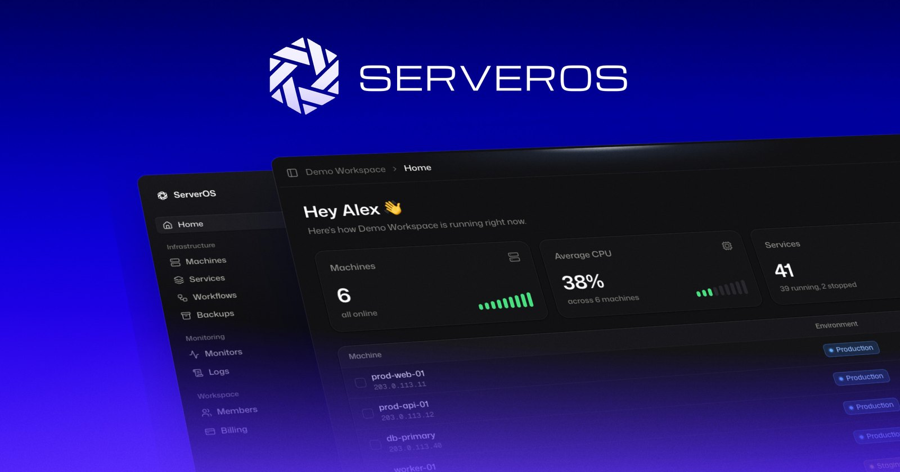

  

  

## One panel for the servers you already own

ServerOS connects to the servers you already rent, at any provider. It finds what's running on them and gives you deploys, backups, monitors, logs and alerts for all of it in one place. Your servers stay yours: your account, your bill, your provider.

- **Connect a server in one command.** A small daemon joins your workspace over one outbound connection, so there are no ports to open.
- **See what's already there.** Websites, databases, containers and workers show up on their own. Nothing is restarted or changed.
- **Run it all from one place.** Deploy your code or a one-click app, back up, monitor, read logs, and automate the rest with workflows.
- **From your AI or your own code.** Every workspace has an MCP server for Claude, ChatGPT and Cursor, and a REST API.

## Links

- [serveros.com](https://serveros.com)
- [Docs](https://docs.serveros.com)
- [Status](https://status.serveros.com)
- [Changelog](https://serveros.com/changelog)
- [Blog](https://serveros.com/blog)

## Source you can read

- [daemon](https://github.com/serveroshq/daemon): `serverosd`, the agent that runs on your servers, and the gateway it connects through. You can read exactly what runs on your machines.

## Get in touch

Questions, ideas or something broken: [support@serveros.com](mailto:support@serveros.com).

ServerOS is made by [ServerOS Cloud Ltd](https://serveros.cloud), registered in England and Wales.
